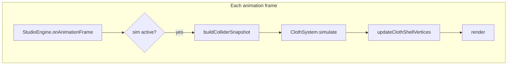

# Cloth physics — implementation guide

> **Note (2026-10-30):** This is the **Silk Studio reference**. Mockup Studio no longer uses OGC-lite displacement bounds or collider slip; its solver (fixed substep pipeline, single friction pass, sleep) is specified in [requirements-physics.md](../requirements/requirements-physics.md) — *Fabric cloth — CPU Verlet*.

This document describes how Silk Studio simulates cloth on the **CPU** today, and how to port the same approach into another project. Normative product rules live in [requirements-scene.md](../requirements/requirements-scene.md).

## Overview

The simulation is a **position-based Verlet** integrator on a regular grid of particles (one vertex per top-shell sample). Rendering uses a **thin double shell** (top + bottom triangles) extruded along the smoothed surface normal; physics moves only the **centerline** particles, then the shell mesh is rebuilt each step.

Collision against the floor and optional scene props (rounded box, sphere) uses **signed distance fields (SDFs)** with a thickness-aware offset `d_hat`. Penetration is reduced further with an **OGC-lite** scheme: per-vertex conservative displacement bounds and collision projection **interleaved** with distance constraints (inspired by [Offset Geometric Contact](https://www.cemyuksel.com/research/papers/Offset_Geometric_Contact-SIGGRAPH2025.pdf), adapted for external analytic colliders only).



## Source map

| Concern | Files |
|--------|--------|
| Orchestration | `src/engine/StudioEngine.ts`, `src/cloth/ClothSystem.ts` |
| Integrator + bounds | `src/physics/verlet.ts`, `src/physics/displacementBounds.ts` |
| Contact constants | `src/physics/contactConfig.ts` |
| Prop / floor SDF | `src/physics/sdfPrimitives.ts`, `src/physics/sceneColliders.ts` |
| Types | `src/physics/types.ts` |
| Public entry (GPU-ready hook) | `src/physics/clothPhysicsBackend.ts` |
| Shell geometry | `src/cloth/shellVertices.ts` |
| Fabric tuning | `src/config/fabricPresets.ts` |
| Pins | `src/pins/PinSystem.ts`, corner indices in `ClothSystem` |

## Data model

### Particle state (per cloth rebuild)

- `pos`, `oldPos`: `Float32Array`, length `(segX + 1) * (segY + 1) * 3` — Verlet positions for the **centerline** only.
- `xPrev`: same layout — penetration-free reference at the current substep (for displacement bounds).
- `pinnedFlags`: `Uint8Array`, `1` = pinned corner particle.
- `constraints`: array of `{ i1, i2, restDist, type }` with `type` ∈ `structural` \| `shear` \| `bending`.

### Parameters per step (`VerletParams`)

- `FabricPhysics`: gravity, damping, bending stiffness, friction, `solverIterations` (default 5).
- `sceneColliders`: snapshot of enabled props (see below).
- Pin data: `pinnedCornersCount`, `cornerIndexMap[4]`, `pinPositions[]`.

### Colliders (`SceneColliderSnapshot`)

Built each sim step from scene props (`src/scene/ScenePropsSystem.ts`):

- **Rounded box**: world `matrixWorld` / `matrixWorldInverse`, `halfExtents`, `cornerRadius`.
- **Sphere**: world center + `radius`.

Hidden layers are omitted from the snapshot.

## Mesh and constraints

On `ClothSystem.rebuild()`:

1. Build a `(segX+1) × (segY+1)` grid in the XZ plane at `START_ELEVATION_Y`, stored in `pos` / `oldPos`.
2. Add **top** and **bottom** triangle sets (double shell) in `BufferGeometry`; simulation indices refer only to the top grid.
3. Generate distance constraints on the grid:
   - **Structural**: edges along X and Y.
   - **Shear**: both diagonals per quad.
   - **Bending**: skip-2, skip-3, and skip-4 neighbors (multiple bands for smoother bending resistance).

Corner vertex indices for pins: `[0, segX, (ny-1)*nx, (ny-1)*nx + segX]`.

## Time stepping

Constants in `verlet.ts`:

| Constant | Value | Role |
|----------|-------|------|
| `SUB_STEPS` | 6 | Substeps per frame (~16 ms frame → `dt = 0.016 / 6` per substep) |
| Frame `dt` | 0.016 s | Assumed fixed step |

### One substep (pseudocode)

```
copy pos → xPrev
for each unpinned particle i:
  Verlet predict with gravity + damping
  resolveSceneCollisions(...)  // floor + props, friction on floor/top faces

repeat solverIterations times:
  for each distance constraint:
    Jacobi-style split correction (respect pins)
  for each unpinned i:
    bound = α * max(clearance(xPrev_i), 0) + β * |v| * dt
    clamp ||pos_i - xPrev_i|| ≤ bound
  project all unpinned particles onto obstacles (SDF, d_hat)
  copy pos → xPrev   // refresh penetration-free reference

repeat CONTACT_EXTRA_PROJECTION_PASSES:
  project all unpinned particles

enforce pin positions on pos and oldPos
```

### Contact thickness `d_hat`

Defined in `contactConfig.ts`:

- `SHELL_HALF_THICKNESS = 0.0006` m (must match shell extrusion in `shellVertices.ts`).
- `CONTACT_D_HAT = 2 * SHELL_HALF_THICKNESS + 0.004` m (~5.2 mm) — minimum SDF clearance for the **centerline**.
- Floor contact: `y >= CONTACT_D_HAT` (ground plane at `y = 0`).

A particle is in violation when `sdf_obstacle(p) < d_hat`; projection pushes along the SDF gradient until `sdf >= d_hat`.

### Displacement bounds (OGC-lite)

`displacementBounds.ts`:

- `clearance(p) = min over obstacles of (sdf(p) - d_hat)` and floor `y - d_hat`.
- `bound = CONTACT_BOUND_ALPHA * max(clearance, 0) + CONTACT_BOUND_BETA * speed * dt` (defaults α=0.35, β=1.0).
- If `||pos - xPrev|| > bound`, clamp the displacement along that segment.

Far from contact → large bound; near contact → small steps without global continuous collision detection.

### Collision response details

`resolveSceneCollisions` (during integration) also:

- Zeros vertical velocity on strong floor / top-face contacts.
- Applies tangential **friction** on floor (slip scaled by `1 - friction`).
- Rounded box uses oriented SDF in local space; gradient transformed to world normals.

`projectSceneCollisions` is the same geometry without velocity/friction — used after constraints.

## From particles to rendered cloth

After each `simulateVerletStep`:

```ts
updateClothShellVertices(geometry, pos, segX, segY, SHELL_HALF_THICKNESS, {
  computeTangents: true,
  computeBounds: false,
});
```

For each grid point, finite differences on `pos` build a smooth normal; top shell vertex = center + normal × halfThick, bottom = center − normal × halfThick.

## Engine integration pattern

To replicate Silk Studio’s loop in another app:

1. **Own the buffers** on a cloth object: `pos`, `oldPos`, `xPrev`, `pinnedFlags`, `constraints`.
2. Each frame when sim should run:
   - Build `SceneColliderSnapshot` from rigid props.
   - Call `stepClothPhysics('cpu', state, params)` (or `simulateVerletStep` directly).
   - Update GPU geometry from `pos`.
3. **Wake / idle**: only call simulate while cloth is moving, camera orbits, or gizmos drag (see [requirements-rendering.md](../requirements/requirements-rendering.md)).
4. **Rebuild** cloth when subdivisions or size change — recompute constraints and reset `originalLocal` for “reset simulation”.

### Minimal TypeScript sketch

```ts
import { simulateVerletStep } from './physics/verlet.ts';
import { updateClothShellVertices } from './cloth/shellVertices.ts';
import { SHELL_HALF_THICKNESS } from './physics/contactConfig.ts';

const state = {
  numVertices,
  pos,
  oldPos,
  xPrev: new Float32Array(numVertices * 3),
  pinnedFlags,
  constraints,
};

const params = {
  gravityMagnitude: 4.2,
  damping: 0.985,
  bendingStiffness: 0.25,
  friction: 0.88,
  solverIterations: 5,
  sceneColliders: snapshot,
  pinnedCornersCount,
  cornerIndexMap,
  pinPositions,
};

simulateVerletStep(state, params);
updateClothShellVertices(geometry, pos, segX, segY, SHELL_HALF_THICKNESS);
```

## Fabric presets vs physics

`fabricPresets.ts` maps UI presets to `FabricPhysics` and optional material roughness/sheen. Physics fields used by the solver:

- `gravityMagnitude`, `damping`, `bendingStiffness`, `friction`, `solverIterations`.

Preset changes should call `cloth.wakeSimulation()` so the idle loop runs until rest.

## Testing

Unit tests: `src/physics/sdfPrimitives.test.ts`, `src/physics/displacementBounds.test.ts`. Run `npm test`.

Manual acceptance: drape cloth over visible cube and sphere; after settle, props should not remain visible through the fabric ([requirements-scene.md](../requirements/requirements-scene.md)).

## Porting checklist

- [ ] Grid particle layout + double-shell render mesh (or single surface if you accept thinner look).
- [ ] Structural / shear / bending distance constraints with pin masks.
- [ ] Verlet substeps + interleaved constraints, bounds, and SDF projection.
- [ ] Shared `d_hat` between contact response and shell half-thickness.
- [ ] Analytic colliders (or replace `sceneColliders.ts` with your own SDF sources).
- [ ] Rebuild shell normals every step after integration.
- [ ] Optional: `clothPhysicsBackend.ts` pattern for a future WebGPU compute pass (same math, parallel per vertex).

## What this is not

- Not a full FEM, XPBD, or IPC/C-IPC solver.
- No cloth–cloth or self-collision (single sheet).
- GPU compute is not implemented yet; `stepClothPhysics` runs CPU Verlet for both `cpu` and `webgpu` backends.
