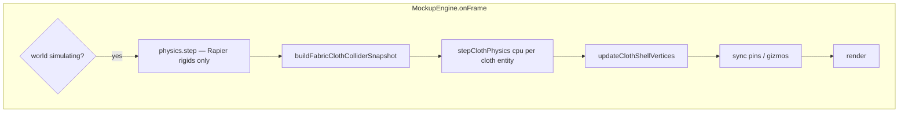

# Fabric cloth — CPU Verlet (Silk Studio port)

**Status:** Plan / Arbeitsdokument (User-Freigabe 2026-10-23). **Stand 2026-10-30:** Port umgesetzt, Solver danach **neu geschrieben** — Abweichungen siehe *Stand 2026-10-30* unten; normativ ist [`requirements-physics.md`](../requirements/requirements-physics.md).  
**Zielverhalten:** [`cloth-physics.md`](./cloth-physics.md) — 1:1 mit Referenz in [`src-silk-studio/`](./src-silk-studio/).  
**Referenz-Quellcode:** `_docs/fabric-physics/src-silk-studio/` (Kopie, nicht builden — Port nach `src/`).

---

## Entscheidungen (bestätigt)

| # | Thema | Entscheidung |
|---|--------|----------------|
| 1 | Rapier für Stoff | **Vollständig ablösen** — kein `SoftBody` / `createSoftBody` für `fabric-cloth` |
| 2 | Solver | Silk Studio: **CPU Verlet + OGC-lite + SDF** |
| 3 | Kontakt | Wie Silk (`contactConfig`, `displacementBounds`, `verlet.ts`) |
| 4 | Pins | **Ja** — 0–4 Ecken, Gizmos wie `PinSystem` |
| 5 | Spawn | **Einstellbar:** Position + Rotation (XYZ); nicht nur Flatlay-Boden-Default |
| 6 | Shell | **Physische Doppelhülle** (Top/Bottom-Triangles aus Centerline) — kein Z-Fight, `d_hat` gekoppelt |
| 7 | `d_hat` / Dicke | Silk Studio (`SHELL_HALF_THICKNESS`, `CONTACT_D_HAT`) |
| 8 | Collider-Set | **Alle Rapier-Collider**, die Mockup Studio heute hat |
| 9 | Posen | Welt-Matrix inkl. **Rotation + uniform `sizeScale`** (wie bestehende Rigid-Collider) |
| 10 | UI Tuning | **Fabric-Settings wie Silk Studio** (`fabricPresets`, Slider, Preset-Buttons) — nicht `resolveFabricDrape` / Rapier-Frequenzen |
| 11 | World loop | **Beste Integration:** Rigids Rapier + Cloth CPU; Wake/Idle wie Silk wo sinnvoll |
| 12 | Bake | Unverändert als **User-Asset-Flow**, Mesh aus **neuer** Shell-Geometrie nach Freeze |
| 13 | Multi-Cloth | Später optimieren — v1 mehrere Instanzen ok |
| 14 | Dieses Doc | Checkliste + Mapping (hier) |

**Requirements nachziehen (vor Merge):** `requirements-physics.md`, `requirements-assets-fabric-cloth.md` (Simulation-Abschnitt), ggf. `requirements-materials.md` (`fabricDrape` → Silk-`FabricPhysics`).

---

## Architektur-Ziel

- **Rapier:** nur **Ground** + **Rigid primitives** (fixed/dynamic) — unverändert für Blöcke, Zylinder, Kugeln, Wheel-Car.
- **Stoff:** eigener State pro `fabric-cloth`-Entity (`pos`, `oldPos`, `xPrev`, `constraints`, `pinnedFlags`, Double-Shell-`BufferGeometry`).
- **Kollision Stoff ↔ Szene:** analytische **SDF** aus Snapshot (nicht Rapier-Partikel-Balls). Posen nach jedem Rapier-Substep (oder einmal pro Frame vor Cloth-Substeps) aus Entity-`matrixWorld`.

---

## Referenz → Ziel-Mapping (`src/`)

Portieren (nahezu 1:1, Pfade an Mockup-Konventionen `@/`):

| Silk (`src-silk-studio/`) | Mockup-Ziel (Vorschlag) | Anmerkung |
|---------------------------|---------------------------|-----------|
| `physics/verlet.ts` | `src/physics/cloth/verlet.ts` | `SUB_STEPS`, Integrator, Constraint-Loop |
| `physics/displacementBounds.ts` | `src/physics/cloth/displacement-bounds.ts` | + Tests portieren |
| `physics/contactConfig.ts` | `src/physics/cloth/contact-config.ts` | `SHELL_HALF_THICKNESS` = Shell-Extrusion |
| `physics/sdfPrimitives.ts` | `src/physics/cloth/sdf-primitives.ts` | + Tests |
| `physics/sceneColliders.ts` | `src/physics/cloth/scene-colliders.ts` | Snapshot-Typen + resolve/project |
| `physics/types.ts` | `src/physics/cloth/types.ts` | `VerletState`, `VerletParams`, constraints |
| `physics/clothPhysicsBackend.ts` | `src/physics/cloth/cloth-physics-backend.ts` | `stepClothPhysics('cpu', …)` |
| `cloth/shellVertices.ts` | `src/physics/cloth/shell-vertices.ts` | Nach Sim Mesh-Update |
| `cloth/ClothSystem.ts` | `src/engine/fabric-cloth-simulation.ts` | Pro Entity oder Manager mit Map |
| `pins/PinSystem.ts` | `src/engine/fabric-cloth-pins.ts` | An Scene-Root, nicht Entity-Child |
| `config/fabricPresets.ts` | `src/config/fabric-physics-presets.ts` | UI + Sim (ersetzt `fabric-cloth-drape.ts` für Sim) |
| `utils/floatBuffer.ts` | `src/physics/cloth/float-buffer.ts` | Klein, shared |

**Nicht portieren (Mockup hat Äquivalent):** Silk `StudioEngine`, `studioStore`, Textur-Pipeline — Material bleibt `createFabricClothMaterial` + Images; optional später Silk-Optics aus `silk-optics.md`.

**Entfernen / ersetzen nach Port:**

| Heute | Aktion |
|--------|--------|
| `src/physics/fabric-cloth-soft-body.ts` | Ersetzen durch Verlet-Session |
| `src/engine/fabric-cloth-physics-colliders.ts` | → `FabricClothSimulationParticipant` (kein Rapier) |
| `src/physics/fabric-cloth-drape.ts` | Sim-Teil entfernen; Presets → `fabric-physics-presets.ts` |
| `PhysicsWorld.createSoftBody` / `hasSoftBodies` | Cloth-Pfad entfernen; `needsSimulationStep` nur Rigids (+ ggf. `worldSimulating`) |
| `fabric-cloth-render-shell.ts` (`positionNode`) | **Entfernen** wenn Double-Shell-Geo aktiv (kein doppeltes Offset) |

**Behalten / anpassen:**

| Modul | Rolle nach Port |
|--------|------------------|
| `fabric-cloth-geometry.ts` | Ruhe-Build → **oder** durch `ClothSystem.rebuild`-Äquivalent ersetzen (Double-Shell + `restPlaneXY`) |
| `fabric-cloth-grid.ts` | Segment-Caps / Zellgröße — an Silk-Subdiv oder bestehende `FABRIC_CLOTH_SIM_CELL_SIZE_M` koppeln |
| `fabric-cloth-grid-normals.ts` | Nur falls Hilfsfunktionen für Shell-Normalen wiederverwendbar |
| `fabric-cloth-bake.ts` | Input = deformiertes Shell-Mesh nach `paused` |
| `fabric-cloth-material.ts` | UV/Cover/Border; UV-Regeln wie Silk `clothShellUv` (Top/Bottom) prüfen |

---

## Collider-Snapshot (Mockup → SDF)

Silk kennt nur **rounded box (Würfel)** + **sphere**. Mockup-Rapier-Collider heute (`rigid-collider-from-entity.ts`):

| `RigidColliderShape` | Rapier heute | SDF für Cloth (v1) |
|----------------------|--------------|---------------------|
| `block` | `roundCuboid` / `cuboid` + `centerOffsetY` | **`sdfRoundBoxLocal`** — `halfExtents` **nicht** uniform: aus `blockColliderShape` (x,y,z), `cornerRadius` = `borderRadiusM`; Matrix = Entity `matrixWorld` × lokaler Offset |
| `sphere` | `ball` + Y-Offset | **`sdfSphereWorld`** — Center/Radius aus Weltpose |
| `cylinder` | `roundCylinder` / `cylinder` | **Neu:** `sdfRoundCylinderLocal` (oder Capsule-Approximation) — gleiche Parameter wie `cylinder-collider-shape.ts` |
| `wheelCar` | rotierter `cylinder` | **Neu:** Zylinder-SDF mit **fester Achsen-Rotation** wie `rigid-collider-desc.ts` (`AXLE_Z_ROTATION`) |
| Ground | Rapier cuboid `y = -GROUND_HALF_THICKNESS` | **Floor-Plane** `y >= CONTACT_D_HAT` wie Silk (`sceneObstacleClearance`) |

**Snapshot-Builder (neu):** `src/physics/cloth/build-scene-collider-snapshot.ts`

- Input: `EntityRegistry`, Liste der Entities mit **aktivem** Physik-Collider (fixed idle + dynamic während Session).
- Pro Entity: `rigidColliderShapeFromEntity` + `runtime.object.matrixWorld` (nach Rapier-Sync bei dynamic).
- **Keine** Stoff-Entities, **kein** Ground-Mesh als Mesh-Collider — nur analytisch.
- Hidden/disabled Layer: wie Silk — aus Snapshot weglassen (Mockup-Layer-Regeln inventarisieren).

**Risiko:** Zylinder/Wheel-SDF müssen **getestet** werden (Gradienten, `d_hat`). Block mit **unterschiedlichen** `halfExtents` ist kein Silk-`halfExtents` scalar — SDF generalisieren (3 Half-Extents).

---

## Entity-Modell & UI

### Spawn-Pose (neu / erweitert)

- Sim-Start: Centerline-Grid in **Entity-Lokalraum** aufbauen, dann **`entity.transform`** (Position, Rotation, uniform Scale) anwenden — Pins in **Welt**.
- Panel-Felder (Vorschlag): Sektion **Simulation spawn** — Position XYZ + Rotation XYZ (Grad oder Rad, konsistent mit Rest der App); Default kann Flatlay bleiben, User override persistent am Entity (`fabricClothSimSpawn` o. ä. in `fabricClothParams` oder eigenes Interface).
- **Reset simulation:** wie Silk `resetSimulationPreservePins` — planare Ruhepose + Pin-Positionen behalten.

### Pins

- Daten: `pinnedCornersCount` (0–4), `activeCornerGizmo`, Pin-Weltpositionen (von Gizmo).
- Gizmo: nur bei `worldPhysicsPhase === 'idle'` **oder** während Sim an Pin-Anchors (Silk: TransformControls an `pinAnchors`) — mit Mockup `GizmoController` integrieren; bei Pin-Drag `wakeSimulation`.
- Corner-Indices: Silk `cornerIndexMap` — Grid-Indexierung **auf Mockup-Grid abstimmen** (Silk: `idx = y*nx+x`; Mockup Partikel: `u*nv+v` — beim Port **ein** Index-Schema wählen, dokumentieren).

### Fabric settings (Silk-Panel-Parität)

Aus `StudioPanel.tsx` + `fabricPresets.ts`:

- Presets: `silk` \| `satin` \| `linen` \| `chiffon` + **custom**
- Slider: bending, gravity, damping, friction; `solverIterations` (Default 5)
- Preset wählen → `fabricPhysics` + optional Material-Roughness/Sheen (Mockup: Roughness aus Material-Preset **oder** gekoppelte Felder — im Implementierungsschritt mit User klären, ob Preset nur Physik oder auch PBR touched)

**Ablösung:** `materials.fabricClothMaterialId` → `fabricDrape.profile` Mapping entfällt für **Physik**; Material-Dropdown bleibt für **Look** (PBR/Procedural).

---

## World-Physics-Session

| Phase | Rigids | Cloth |
|-------|--------|-------|
| `idle` | Fixed colliders in Rapier (wie heute) | Kein Verlet-State (oder cold) |
| `simulating` | `physics.step` | Pro Frame: Snapshot → `simulateVerletStep` → Shell-Update |
| `paused` | Sleeping / no step | Kein Sim; Mesh eingefroren → **Bake** |
| `reset` | Snapshot transforms | Cloth rebuild + Pins default |

**Teilnehmer:** `FabricClothSimulationParticipant` implementiert `WorldPhysicsDynamicParticipant`:

- `spawnSessionDynamics()` — init Verlet + Pins aus Entity-Spawn
- `syncEntityTransformsFromPhysics()` — Mesh sync (ersetzt Rapier-SoftBody-Sync)
- `setAllSleeping(true)` — Sim-Flag off (paused)
- `clearSessionDynamics()` — restore rest mesh

**Frame-Taktung:** In `MockupEngine.onFrame` nach `physics.step` und vor `worldPhysics.tick`:

1. Collider-Snapshot bauen (dynamic poses aktuell).
2. Cloth step (wenn `simulating` und nicht cloth-sleeping).
3. `worldPhysics.tick` sync nur noch Cloth + ggf. rigid mesh sync (unverändert).

**Wake / Idle (Silk):** `ClothSystem` REST_FRAMES — wenn keine Bewegung und keine Kamera/Gizmo/Pin-Activity, Sim überspringen aber bei `simulating` Session weiter “bereit”. Mockup: `needsSimulationStep` erweitern oder `continuous` aus Cloth-`isAwake()` — Ziel: keine Dauer-CPU wenn Tuch liegt.

---

## Geometrie & Rendering

1. **Rebuild** bei: Bild, Maß, Subdiv, Material (UV), Border, Spawn-Params.
2. **Double-Shell:** `totalVerts = 2 * (segX+1)*(segY+1)` — wie `ClothSystem.rebuild`.
3. **`updateClothShellVertices`** nach jedem Sim-Step mit `SHELL_HALF_THICKNESS` aus `contact-config`.
4. **Schatten:** cast/receive auf Cloth-Mesh; `d_hat` verhindert Durchdringen — keine 5 mm Rapier-Balls mehr.
5. **`restPlaneXY`:** weiter für Border-TSL auf **Ruhe-**Plane-Koordinaten (beim Rebuild setzen, nicht mit Centerline mitbewegen).

---

## Bake

- Voraussetzungen unverändert: `paused`, selektiertes `fabric-cloth`, aktive Session.
- `getClothMeshForBake` → Shell-Mesh mit deformierten Positionen (wie heute, neues Backend).
- Glättung `fabric-cloth-bake.ts` bleibt; Tests anpassen.

---

## Implementierungs-Phasen

### Phase A — Docs & Datenmodell
- [x] Requirements aktualisieren (Rapier-Stoff raus, Verlet rein, Kontakt `d_hat`, Pins, Spawn, UI)
- [x] Entity-Felder: `fabricClothParams` / Sim-Spawn / Pin-Count serialisieren
- [x] Diary-Eintrag (siehe `diary-code-decisions.md`)

### Phase B — Physics-Kern portieren
- [x] `src/physics/cloth/*` aus `src-silk-studio/physics/*` (Tests: `sdfPrimitives`, `displacementBounds`)
- [x] Block-SDF auf **3 half extents** erweitern (Mockup-Blocks sind nicht Würfel)

### Phase C — Collider-Snapshot
- [x] `build-scene-collider-snapshot.ts` + Zylinder/Wheel SDF
- [x] Integrationstest: Tuch auf Block/Kugel, kein Durchdringen (Silk-Akzeptanz)

### Phase D — `FabricClothSimulation` + Mesh
- [x] Port `ClothSystem` Logik (Constraints, rebuild, simulate, rest detection)
- [x] Ersetzen `buildFabricClothMesh` / Session-Init
- [x] Engine-Participant statt `FabricClothPhysicsColliders`

### Phase E — Pins & Gizmos
- [x] `fabric-cloth-pins.ts` + GizmoController-Hooks
- [x] UI: Pin count, Corner-Buttons (wie Silk)

### Phase F — UI Fabric Physics
- [x] Sektion in `FabricClothFields` oder Physics-SubPanel (Presets + Slider)
- [x] `wake` bei Preset/Slider-Change während Session

### Phase G — Aufräumen
- [ ] Rapier SoftBody API entfernen / ungenutzt
- [ ] Alte Tests migrieren (`fabric-cloth-soft-body.test.ts` → Verlet)
- [ ] `npm run lint` + `npm run build` + `npm test`
- [ ] Shader-Render-Shell entfernen wenn Double-Shell live

---

## Offene technische Punkte (Implementierung)

1. **Grid-Segmente:** Silk Default 38×38 vs Mockup `FABRIC_CLOTH_SIM_CELL_SIZE_M` (~36×36 bei 0,45 m) — harmonisieren (eine Formel, dokumentieren).
2. **Index-Konvention** Partikel vs Three `PlaneGeometry` Vertices — beim Port explizit mappen (historisch `particleToVertex` in Rapier-Pfad).
3. **Wheel-Car SDF:** exakt vs vereinfachte Capsule — Priorität visueller Kontakt.
4. **Preset → PBR:** Silk setzt `roughness`/`sheen` aus Fabric-Preset — Mockup entkoppeln oder Preset-Apply auf `fabricClothMaterialId`?
5. **Export:** Contact shadows mit neuer Geometrie — Regressionstest manuell.

---

## Akzeptanz (kurz)

- Stoff drapiert wie Silk-Demo über Block/Kugel/Zylinder — **kein** Durchscheinen nach Settle.
- Pins halten Ecken; Gizmo bewegt Pin während Sim.
- Spawn-Pose ändert Startlage ohne Mesh-Ratio-Verzerrung.
- World Physics Start/Pause/Reset/Bake wie bisher funktional.
- Kein Rapier-`SoftBody` mehr im Repo für `fabric-cloth`.

---

## Quellen im Repo

| Doc / Code | Zweck |
|------------|--------|
| [`cloth-physics.md`](./cloth-physics.md) | Normative Sim-Beschreibung |
| [`src-silk-studio/`](./src-silk-studio/) | Port-Quelle |
| [`interactive_silk_cloth_studio (7).html`](../examples/interactive_silk_cloth_studio%20(7).html) | Historische Demo (weniger OGC als TS) |
| [`silk-optics.md`](./silk-optics.md) | Optional später für Look-Parität |

---

## Stand 2026-10-30 — Abweichungen vom Silk-Port

| Thema | Plan (oben) | Ist |
|---|---|---|
| Kontakt | OGC-lite (`displacementBounds`), Slip/`oldPosY` in Collidern, Extra-Projektionspässe | **Entfernt.** Ein Pfad `projectPointOutOfObstacles` (Push + Normale); Tuch rutschte/raste weg |
| Reibung | in Predict + Collider-Slip | **Nur** Schritt 4 im Substep, auf Substep-Verschiebung, mit Haftreibung |
| Substep | Silk-Reihenfolge mit Bounds/`xPrev` | Predict → (Constraints → Collide) × N → Reibung → Pins; kein `xPrev` |
| Wake/Idle | Silk REST_FRAMES | Sleep nach 30 Ruhe-Frames; Wake per Fingerprint (Pins, Collider, Params) + Ecken-Drag |
| Backend | `cloth-physics-backend.ts` (`stepClothPhysics('cpu')`) | Entfernt — direkter Aufruf `simulateVerletStep` |
| Bake-Glättung | `fabric-cloth-bake.ts` bilinear | **Catmull-Rom** ×3, Basis-Pivot, Zeilen-Spiegelung; `fabric-cloth-bake-align.ts`, `fabric-cloth-grid-normals.ts` entfernt |

