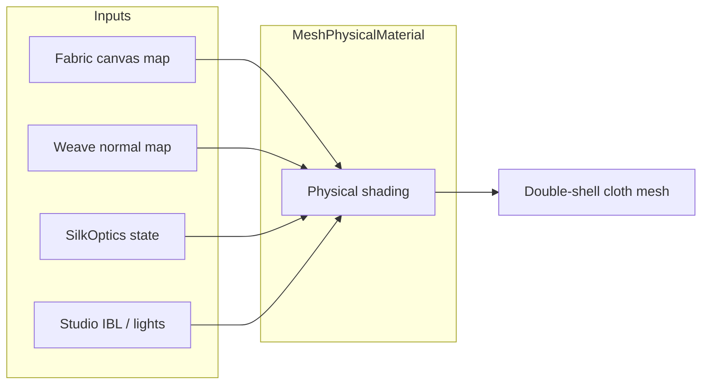

# Silk optics — implementation guide

This document explains how Silk Studio shades the cloth as **silk-like PBR** and how to reproduce the same look in another Three.js project. UI sliders and presets are defined in `src/config/silkOptics.ts` and [requirements-ui.md](../requirements/requirements-ui.md).

## Overview

The visible cloth is one `MeshPhysicalMaterial` on a double-shell mesh. Appearance comes from three layers:

1. **Albedo** — `CanvasTexture` from `FabricCanvasTexture` (default pattern or user upload).
2. **Micro-relief** — procedural **weave normal map** (`createWeaveNormalTexture()`).
3. **Silk-specific PBR extensions** — Three.js physical layers: **anisotropy**, **sheen**, **iridescence**, plus standard roughness/metalness and IBL from the studio environment.



## Source map

| Concern | Files |
|--------|--------|
| Optics schema + defaults | `src/config/silkOptics.ts` |
| Material create / update | `src/cloth/ClothSystem.ts` (`rebuild`, `applySilkOptics`, `applyPresetMaterial`) |
| Weave normals | `src/textures/weaveNormal.ts` |
| Print / upload texture | `src/textures/canvasTexture.ts` |
| UI + store | `src/ui/StudioPanel.tsx`, `src/state/studioStore.ts` |
| Preset roughness/sheen | `src/config/fabricPresets.ts` (applied via engine when preset changes) |
| Lighting / env | `src/engine/applyStudioLighting.ts`, `src/scene/studioEnvironment.ts` |

## `SilkOptics` fields

```ts
export interface SilkOptics {
  anisotropy: number;           // 0–1, default 0.85
  anisotropyRotation: number;   // radians, default π/4
  sheen: number;                // 0–1, default 0.3
  sheenRoughness: number;       // 0–1, default 0.5 (fixed at rebuild today)
  sheenColor: number;           // hex, default 0xd4d4d8
  iridescence: number;          // 0–1, default 0.35
  iridescenceIOR: number;       // default 1.33 (fixed at rebuild today)
  weaveDepth: number;           // normal scale, default 0.4
}
```

`createDefaultSilkOptics()` returns the defaults above. The store keeps a single `silkOptics` object; sliders call `setAnisotropy`, `setSheen`, etc., then the engine calls `cloth.applySilkOptics(state.silkOptics)`.

## Material setup (portable recipe)

On cloth rebuild, Silk Studio creates:

```ts
new MeshPhysicalMaterial({
  color: 0xffffff,
  map: fabricTexture.texture,       // sRGB canvas texture
  roughness: 0.3,                   // overridden by fabric preset
  metalness: 0.0,
  sheen: silkOptics.sheen,
  sheenRoughness: silkOptics.sheenRoughness,
  sheenColor: new Color(silkOptics.sheenColor),
  anisotropy: silkOptics.anisotropy,
  anisotropyRotation: silkOptics.anisotropyRotation,
  iridescence: silkOptics.iridescence,
  iridescenceIOR: silkOptics.iridescenceIOR,
  iridescenceThicknessRange: [100, 350],  // nm-style range for thin-film
  normalMap: weaveNormal,
  normalScale: new Vector2(silkOptics.weaveDepth, silkOptics.weaveDepth),
  clearcoat: 0.0,
  clearcoatRoughness: 0.1,
  specularIntensity: 0.6,
  envMapIntensity: 0.45,
  depthWrite: true,
  depthTest: true,
});
```

### What each knob does visually

| Parameter | Effect |
|-----------|--------|
| **Anisotropy** | Stretches specular highlights along warp/weft; high values = characteristic silk streaks. |
| **Anisotropy rotation** | Rotates the anisotropy direction in the tangent plane (UI shows degrees, store uses radians). |
| **Sheen** | Adds a soft, fabric-like grazing highlight (Charlie/sheen lobe in physical shader). |
| **Sheen color** | Tints sheen (cool gray default). |
| **Iridescence** | Thin-film color shift on specular; subtle on silk, stronger on chiffon preset. |
| **Weave depth** | Scales the weave `normalMap` — micro-shadowing without changing geometry. |

### Live updates without rebuild

`applySilkOptics` updates only the fields exposed in the UI (not `sheenRoughness`, `sheenColor`, or `iridescenceIOR`):

```ts
material.anisotropy = optics.anisotropy;
material.anisotropyRotation = optics.anisotropyRotation;
material.sheen = optics.sheen;
material.iridescence = optics.iridescence;
material.normalScale.set(optics.weaveDepth, optics.weaveDepth);
material.needsUpdate = true;
```

Fabric **presets** (`silk`, `satin`, `linen`, `chiffon`) additionally call `applyPresetMaterial(roughness, sheen, sheenColor, anisotropy?, iridescence?)` so physics and base PBR stay coherent when switching preset.

## Weave normal map

`createWeaveNormalTexture()` (`src/textures/weaveNormal.ts`):

- 256×256 `CanvasTexture`, **repeat** wrapping, `NoColorSpace` (linear normal data).
- Simplex noise at multiple phases builds tangent-space normals (warp / weft / diagonal).
- Assigned once per `ClothSystem` lifetime; only `normalScale` changes with `weaveDepth`.

To port: generate any tileable normal map (procedural or authored) and assign to `normalMap`; drive strength with `normalScale`.

## Fabric color / print

`FabricCanvasTexture`:

- `texture.flipY = false` — paired with `clothShellUv()` so the print reads LTR from a top-down view (see [docs/README.md](./README.md#fabric-texture-print-side)).
- `colorSpace = SRGBColorSpace`, mipmaps + anisotropy 8.
- User images are drawn aspect-correct into the canvas; the material `map` is refreshed on upload.

White `material.color` keeps albedo faithful to the canvas.

## Lighting dependencies

Silk optics assume a lit studio scene:

- **PMREM environment** on WebGL (see `applyStudioLighting` / `studioEnvironment.ts`).
- Directional key/fill/top lights with shadows (VSM on WebGL).

`envMapIntensity: 0.45` avoids blown specular on bright IBL. If you port to a minimal scene, raise env intensity or add a key light until sheen and anisotropy are visible.

## Renderer backends

- **Default WebGL**: full `MeshPhysicalMaterial` with anisotropy, sheen, iridescence.
- **Opt-in WebGPU** (`?webgpu=1`): Three.js maps physical materials to the node pipeline; keep the same material properties — verify sheen/iridescence on your Three.js version.

No custom shaders are required for the silk look; it is stock physical shading.

## Integration steps for another project

1. **Mesh**: Use a subdivided plane or double shell with tangents (`computeTangents()` after shell update).
2. **Textures**: Color map (sRGB) + tileable normal map (linear).
3. **Material**: `MeshPhysicalMaterial` with the fields above; start from `createDefaultSilkOptics()`.
4. **State**: Hold a `SilkOptics` object in your app state; on change, patch the material (pattern in `applySilkOptics`).
5. **Presets** (optional): Table of `{ roughness, sheen, sheenColor, anisotropy?, iridescence? }` like `FABRIC_PRESETS`.
6. **Environment**: Provide PMREM or equivalent IBL; tune `envMapIntensity` and `specularIntensity` together.

### Minimal example

```ts
import {
  Mesh,
  MeshPhysicalMaterial,
  Color,
  Vector2,
} from 'three';
import { createDefaultSilkOptics } from './config/silkOptics.ts';
import { createWeaveNormalTexture } from './textures/weaveNormal.ts';

const optics = createDefaultSilkOptics();
const weaveNormal = createWeaveNormalTexture();

const material = new MeshPhysicalMaterial({
  map: colorTexture,
  normalMap: weaveNormal,
  normalScale: new Vector2(optics.weaveDepth, optics.weaveDepth),
  roughness: 0.32,
  metalness: 0,
  sheen: optics.sheen,
  sheenRoughness: optics.sheenRoughness,
  sheenColor: new Color(optics.sheenColor),
  anisotropy: optics.anisotropy,
  anisotropyRotation: optics.anisotropyRotation,
  iridescence: optics.iridescence,
  iridescenceIOR: optics.iridescenceIOR,
  iridescenceThicknessRange: [100, 350],
  specularIntensity: 0.6,
  envMapIntensity: 0.45,
});

const mesh = new Mesh(geometry, material);
scene.environment = pmremTexture; // required for convincing silk highlights
```

## Tuning tips

- **More “silky”**: raise `anisotropy` (0.7–0.9), moderate `sheen` (0.2–0.4), keep `roughness` under ~0.35.
- **Less plastic**: lower `specularIntensity` or raise `roughness` slightly; avoid `metalness > 0`.
- **Stronger weave**: increase `weaveDepth`; too high will look bumpy under grazing light.
- **Iridescence**: keep ≤ 0.4 unless you want a fashion-film look; pair with `iridescenceThicknessRange` sweeps.

## Related docs

- [cloth-physics.md](./cloth-physics.md) — simulation and shell mesh (orthogonal to shading).
- [requirements-rendering.md](../requirements/requirements-rendering.md) — fabric UV orientation and render loop.
