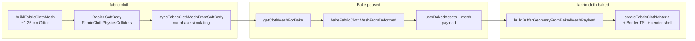

# improve-04 — Fabric cloth (Bake, Grid, Border)

Offene Punkte aus Review. **A** erledigt. **B / E** nicht Fabric-Scope. Unten: **Analyse** zu Grid/Bake (**F**), Border (**C**), flache Bakes (**D**).

---

## Checkliste (kurz)

| ID | Thema | Status |
|----|--------|--------|
| A | Export-Schatten kariert | **erledigt** (8192² Shadow Maps + adaptive Spot-Coverage) |
| B | Apfel-C / Apfel-V Kopieren | offen |
| C | Border bei `fabric-cloth-baked` kaputt (nicht rundherum, schief) | **Analyse → unten** |
| D | Manche Bakes flach | **Analyse → unten** |
| E | Farbauswahl ruckelig | offen |
| F | Bake nicht höher aufgelöst / kein „doppeltes Grid“ | **Analyse → unten** |

Normativ: [`requirements-assets-fabric-cloth.md`](../requirements/requirements-assets-fabric-cloth.md) (*Bake — User Asset*, *Border*, *Fold smooth*).

---

## Kette: Sim → Freeze → Bake → Platzierung

| Schritt | Code | Hinweis |
|---------|------|---------|
| Sim-Gitter | `fabricClothGridSegments` → `buildFabricClothMesh` | Zelle `FABRIC_CLOTH_SIM_CELL_SIZE_M` (12,5 mm), `round(extent/cell)`, max **64** Segmente/Achse |
| Vertex-Sync | `WorldPhysicsSessionController.tick` | Nur bei `simulating`; bei `paused` **kein** weiterer Sync |
| Bake erlaubt | `canBakeEntity` + `hasFabricClothSession` | `paused`, selektiertes `fabric-cloth`, aktive Cloth-Session |
| Draft | `mockup-engine.buildBakeFabricClothDraft` | `getBindingForBake` (flush) → `bakeFabricClothMeshFromVerletBinding` — **Verlet-Centerline** mesh-lokal, nicht Top-Shell-Rohbuffer |
| Katalog | `bakeSelectedToUserAsset` | Klont `mesh` inkl. `segmentsW/H`, `restPlaneXY`, deformierte `positions` |
| Instanz | `addBakedFabricCloth` | Geometrie aus Payload, Material wie Live-Cloth (`planeWidthM`/`planeHeightM` aus Payload) |

---

## Grid & Auflösung (F + „zu wenig Grid“)

### Soll (Requirements + Konstanten)

- Sim: festes ~**1,25 cm** Gitter (`FABRIC_CLOTH_SIM_CELL_SIZE_M`).
- Bake: **dichteres** Gitter einmalig beim Bake — `FABRIC_CLOTH_BAKE_SUBDIV_FACTOR` (**4×** Segmente/Achse vs. Sim), zusätzlich Zielzelle `FABRIC_CLOTH_BAKE_CELL_SIZE_M` (= Sim/4, ~**3,1 mm**), Deckel `FABRIC_CLOTH_BAKE_MAX_VERTICES` (65 536).
- Implementierung: `resolveDenseBakeSegments` in `src/engine/fabric-cloth-bake.ts` = `max(coarse×factor, ceil(extent/bakeCell))`, dann Vertex-Cap.
- Glättung: **bilineare** Interpolation der groben Sim-Vertices auf das dichte Gitter — **kein** Rapier auf feinem Gitter, **kein** bicubic (Requirements nennen bicubic nur als Ziel).

### Ist (rechnersich, typische 0,45×0,45 m)

| | Segmente W×H | Dreiecke (ca.) |
|--|----------------|----------------|
| Sim | 36×36 | 2 592 |
| Bake | 144×144 | 41 472 (**~16×**) |

Größere Tücher: Sim capped bei **64**; Bake wächst bis Cap (z. B. ~255×255 bei 2×2 m, dann Vertex-Clamp).

### Warum es trotzdem „wie Sim“ wirken kann

1. **Falsches Objekt vergleichen:** Nach Bake bleibt die **Quell-`fabric-cloth`** in der Szene (grobes Gitter). Das gebackene Asset ist ein **neuer** Katalog-Eintrag — erst nach Drop/Add sichtbar.
2. **Bake glättet nur, erfindet keine Falten:** Feineres Gitter interpoliert zwischen **denselben** Sim-Knoten — Falten**zahl** bleibt, nur Kanten weicher. Erwartung „mehr Falten-Detail“ trifft den Code nicht.
3. **Sim selbst wirkt grob:** Live während `simulating`/`paused` immer Sim-Gitter — Bake verbessert **nur** die stiff-Kopie.
4. **Prüfen statt raten:** Nach Bake zeigt **Physics** den Hint `sim W×H → bake W×H · N triangles` (`lastFabricClothBakeSummary`). Assets-Liste: `formatFabricClothBakedMeshSubtitle` (z. B. `144×144 · … tris`). Wireframe auf **platzierter** `fabric-cloth-baked`-Instanz.

### Wenn Hint **keine** 4× Segmente zeigt

Dann Bug in `bakeFabricClothMeshFromDeformed` / Payload / Anzeige — Tests (`fabric-cloth-bake.test.ts`) erwarten >3× Dreiecke vs. Sim; bei dir dann reproduzierbare Maße (Footprint, Hint-Zeile) notieren.

### Wenn Hint stimmt, Look aber nicht

- Produkt: höherer `FABRIC_CLOTH_BAKE_SUBDIV_FACTOR`, kleinere Bake-Zelle, oder bicubic / Normal-Glättung (Scope-Änderung, Requirements anpassen).
- Optional: **Sim-Gitter** dichter (eigenes Requirement; heute max 64/Achse).

---

## C — Border bei `fabric-cloth-baked`

### Soll

Inset-Bordüre auf **gesamter** Bahn, **rest-plane**-basiert (`restPlaneXY`), Footprint unverändert — [`requirements-assets-fabric-cloth.md`](../requirements/requirements-assets-fabric-cloth.md).

### Code-Pfad (Live = Baked)

- `createFabricClothMaterial` → `applyFabricClothInsetBorderToMaterial` (`fabric-cloth-border-nodes.ts`): Maske aus Attribut `restPlaneXY`, nicht aus deformiertem `position`.
- Live-Mesh: `restPlaneXY` beim Build in `fabric-cloth-geometry.ts` (frozen).
- Bake: `restPlaneXY` aus **flachem** dichten Grid in `bakeFabricClothMeshFromDeformed`; Rebuild via `buildBufferGeometryFromBakedMeshPayload`.
- Material-Maße: Live `faceWidth/faceHeight`; Baked `meshPayload.planeWidthM/planeHeightM` (sollten mit `bakedClothFootprint` übereinstimmen).

**Kein separater „baked border“-Shader** — gleiche TSL; Unterschiede nur Geometrie/Attribute/Daten.

### Wahrscheinliche Ursachen (priorisiert)

1. **Cover-UV vs. Rest-Border:** Motiv nutzt `uv()` + Cover (`coverUvNode`); Border nutzt `restPlaneXY`. An **geschnittenen** Bildkanten kann ein **Motiv-Streifen** wie eine schiefe „Bordüre“ wirken, obwohl die echte Border-Maske symmetrisch ist (Top-Down / ohne Border testen).
2. **`restPlaneXY` fehlt oder falsch:** Maske bricht (Test `fabric-cloth-border-nodes.test.ts`: Border aus `position` statt `rest` → falsch). Prüfen: platzierte Instanz, Geometrie-Attribut `restPlaneXY` gesetzt, Länge = 2× Vertexcount.
3. **`planeW`/`planeH` ≠ Rest-Ausdehnung:** Border-Inset in Metern passt nicht zum gespeicherten Rest-Rechteck (z. B. manuell kaputtes Payload, sehr unwahrscheinlich im Normalflow).
4. **Render-Shell** (`positionNode` + `DoubleSide`): Kann Bordüre schräg zur Kamera wirken lassen; sollte Live und Baked gleich betreffen — wenn nur Baked: eher Normale/Geometrie-Dichte, nicht Logik-Unterschied.
5. **Parameter nur auf Instanz geändert** ohne Rebuild: `setFabricClothParams` triggert Rebuild für Family — sollte Material neu bauen.

### Empfohlene Repro / Debug

- Gleiches Bild, Border an: **Live `paused`** vs. **platziertes baked** von derselben Pose.
- Border **aus**, nur Motiv: bleibt der schiefe Streifen? → UV/Cover, nicht Border-TSL.
- DevTools: Vertex an Rest-Kante — `restPlaneXY` ±halfW/halfH; Maske `fabricClothBorderMaskFromRestPlane` CPU.

---

## Verlet bake coordinates (2026-10-24)

- **Sim-State:** `binding.pos` = Welt-Centerline; `flushBindingShell` → `fabricClothMeshLocalCenterlineFromBinding` → Double-Shell-Geometrie.
- **Bake:** `bakeFabricClothMeshFromVerletBinding` — bilineare Dichte aus **derselben** mesh-lokalen Centerline (Payload = plane-local vor `rotation.x = -π/2`, wie `user-baked-asset.ts`).
- **Tests:** `fabric-cloth-bake-roundtrip.integration.test.ts` — Entity-lokal AABB Referenz (Centerline) vs. platziertes stiff-Mesh nach Rebuild.
- **Symptom „nur baked versetzt“:** Centerline-Bake + **`alignFabricClothBakePayloadToSourceMesh`** (Entity-lokal AABB: min-Y + X/Z-Zentrum vs. Live-Shell beim Bake).
- **Alte Katalog-Einträge:** neu backen — Alignment liegt im Payload, nicht in Placement.

---

## D — Manche Bakes „flach“

### Erwartung

Bake serialisiert **aktuelle** Mesh-`position` (lokal, vor Mesh-Rotation −90° X). Flach = alle relevanten Z-Offsets (lokal) ~0 bzw. keine sichtbare Drape-Pose im Payload.

### Wahrscheinliche Ursachen

| Ursache | Mechanismus |
|---------|-------------|
| **Rebuild vor Bake** | `rebuildFabricCloth` ruft `fabricClothPhysics.refreshOne` → `restoreFabricClothRestPositions` + neues SoftBody vom **flachen** Mesh. Pose weg, Session wieder „frisch“. Typisch nach Image/Material/Dimension-Change während `paused`. |
| **Kaum / keine Sim** | Freeze direkt nach Start → Pose ≈ Ruhe (flach auf Boden). Technisch korrekt, wirkt wie „Bake kaputt“. |
| **Kein finaler Sync nötig** | Bei `paused` letzter `simulating`-Tick sollte Mesh bereits deformiert sein; Bake liest CPU-Buffer. **Kein** expliziter `syncFabricClothMeshFromSoftBody` vor Bake — nur relevant, wenn Buffer je out-of-sync (unwahrscheinlich). |
| **Falsche Quelle angeschaut** | Quell-`fabric-cloth` nach Rebuild flach; Katalog-Eintrag von **früherem** Bake noch drapiert (oder umgekehrt). |
| **Payload / Placement** | Selten: `positions` im Store leer/flat — `buildBufferGeometryFromBakedMeshPayload` würde bei Segment-Mismatch werfen; bei allen z≈0 kein Throw. |

### Empfohlene Repro

1. Start → kurz simulieren → **Freeze** (ohne Szene-Rebuild: kein Image/Material/Size ändern).
2. Bake → Hint notieren → **neu platzieren** → mit Quell-Mesh vergleichen.
3. Wenn flach: unmittelbar vor Bake prüfen, ob Quell-Mesh noch drapiert ist (Viewport).

### Fix-Richtung (später, nicht implementiert)

- Vor Bake: **erzwungener** `syncFabricClothMeshFromSoftBody` aus Rapier.
- `refreshOne` bei `paused`: Pose vom SoftBody auf neues Mesh **übernehmen** statt Rest (größerer Eingriff).
- UX: Bake disabled / Warnung wenn Rebuild seit letztem Freeze die Pose zurückgesetzt hat.

---

## Nächste Schritte (Implementierung — nach Freigabe)

1. **F / Grid:** Repro mit Hint + Wireframe auf **platzierter** Instanz; ggf. `SUBDIV_FACTOR`/Bake-Zelle oder bicubic; optional Sim-Dichte (Requirements).
2. **C:** Repro Border vs. Cover entkoppeln; ggf. Integrationstest Baked-Geometrie + `restPlaneXY` + Maske an 4 Kanten.
3. **D:** Repro mit/ohne `refreshOne`; Pre-Bake-Sync + Freeze-Rebuild-Policy.
